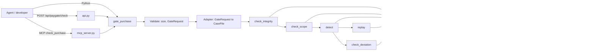

# Design Document: PayGate

## Overview

PayGate is a pre-purchase gate over the existing IntentTrace checks. An agent submits a proposed Cart Mandate, the signed Intent Mandate, and the untrusted text it read. PayGate runs the same integrity, scope, detection, best-match and replay code that the post-purchase investigator uses, applies a fixed ordered rule table, and returns `ALLOW`, `BLOCK`, or `ASK_HUMAN`. Every result is written to a signed, hash-chained log.

Design decisions and rationale:

- **No new detection logic.** PayGate adapts a `GateRequest` into a `CaseFile` and calls `check_integrity`, `check_scope`, `detect`, `check_deviation`, and `replay` unchanged. The gate and the investigator cannot disagree on the same facts (Req 4).
- **Pure rule function.** The decision lives in `decide_from_facts(facts)`, a pure function with no I/O. It is the main target for property tests.
- **Deterministic by default.** No provider means rule-only `detect` and zero network calls. The LLM path is opt-in through `INTENTTRACE_LLM_PROVIDER`.
- **Fail toward a human.** Any uncertainty returns `ASK_HUMAN` or `BLOCK`. `ALLOW` is returned only when integrity, scope, and detection all ran to completion and were clean.
- **Log stores hashes, not content.** The decision record holds a request hash and span offsets. Untrusted text is never persisted.

Grounding in the real code (read before writing this design):

| Existing module | Fact that shapes the design |
|---|---|
| `models.py` | `CaseFile` requires `payment`, `trace`, `public_keys`. `_Model` forbids extra fields and rejects Luhn-valid card numbers (covers Req 1.3, 1.5). `TraceStep.source` allows only `user, merchant, review, external_agent, agent`. |
| `checks/integrity.py` | Verifies intent, cart, **and payment** signatures plus hash links. Findings carry `field` (for example `payment.signature`). No payment exists before purchase. |
| `checks/scope.py` | `check_scope(case)` returns `ScopeResult.violations`, one `Finding` per violated constraint. |
| `forensics/detect.py` | Only steps with source `merchant`, `review`, `external_agent` are scanned. `detect(case, None)` is rules-only. LLM failure adds a `llm_unavailable` finding. |
| `forensics/deviation.py` | `check_deviation(instruction, constraint, listings, chosen_id)` reads only title, price, attributes. |
| `forensics/replay.py` | `replay(case, spans, enabled)` needs a scripted `agent_config`, the merchant `observe` step per product, and `original_choice(case)` (last `decide` step, else first cart item). |
| `crypto.py` | `canonical`, `sign`, `verify`, `mandate_hash`, `generate_keypair` work on any pydantic model with a `signature` field. Reused for the log. |
| `store.py` | SQLite at `db_path()` (`INTENTTRACE_DB`). Each caller opens its own connection. |
| `api.py` / `mcp_server.py` | `create_app()` and `create_server()` register routes and tools. The existing `_provider()` defaults to `fake`. |
| `bench.py` | `write_results` rewrites both `results.json` and `RESULTS.md` wholesale. Labels carry `label`, `cause`, `attack_type`. |
| `web/src` | React Router app, `api.ts` fetch helpers, `VerdictBadge`, CSS variables for themes. |

## Architecture



### Data flow

1. **Validate.** Reject payloads over 1 MB, then validate with `GateRequest`. Failure returns `ASK_HUMAN / INPUT_MALFORMED` with JSON paths.
2. **Adapt.** Build a `CaseFile` (see Adapter below).
3. **Run checks in order, short-circuiting.** Integrity, then scope. Either one with findings ends evaluation with `BLOCK`. Then detect, then replay (only if spans were flagged), then deviation.
4. **Decide.** Collect `Facts` and call `decide_from_facts`.
5. **Explain.** Fill the template for the primary Reason_Code. No LLM, no untrusted text in the output.
6. **Log.** Append one signed record in a single `BEGIN IMMEDIATE` transaction. If the write fails, return `ASK_HUMAN / CHECK_FAILED`.
7. **Return** the `GateResult`.

### New and changed files (MVP)

| File | Change |
|---|---|
| `src/intenttrace/paygate.py` | New. Models, adapter, rule table, explanations, `gate_purchase`. |
| `src/intenttrace/paygate_log.py` | New. `DecisionLog`, key handling, `verify_decision_log`, evidence rendering. |
| `src/intenttrace/api.py` | Add 4 routes. |
| `src/intenttrace/mcp_server.py` | Add `check_purchase` and register it. |
| `src/intenttrace/bench.py` | Add `case_to_request`, `run_paygate_bench`, PayGate section writer. Make `write_results` keep an existing PayGate block. |
| `src/intenttrace/cli.py` | Add `paygate-bench` command. |
| `web/src/pages/DecisionsPage.tsx`, `components/DecisionBadge.tsx`, `api.ts`, `types.ts`, `App.tsx` | New page, badge, types, route, nav link. |
| `README.md`, `.github/workflows/ci.yml`, `.gitignore`, `pyproject.toml` | PayGate section, CI step, key file ignore, `hypothesis` dev dependency. |

No existing check, forensics, or evidence module changes behavior.

## Components and Interfaces

### Python API (`intenttrace/paygate.py`)

```python
Decision = Literal["ALLOW", "BLOCK", "ASK_HUMAN"]
ReasonCode = Literal[
    "INTEGRITY_SIGNATURE_INVALID", "INTEGRITY_HASH_CHAIN_BROKEN",
    "INTEGRITY_TOTAL_MISMATCH", "INTEGRITY_SIGNER_VIOLATION",   # added, see Review Notes
    "SCOPE_VIOLATION", "INJECTION_DETECTED", "BEST_MATCH_DEVIATION",
    "REPLAY_CHANGED_CHOICE", "INPUT_MALFORMED", "CHECK_FAILED", "CLEAN",
]

def gate_purchase(
    request: GateRequest | dict,
    provider: LLMProvider | None = None,   # None = rules only, zero network calls
    replay: bool = True,
    *,
    log: DecisionLog | None = None,        # tests and benchmark inject a temp log
) -> GateResult: ...                        # never raises

def decide_from_facts(facts: Facts) -> Outcome: ...    # pure, no I/O
def request_to_case(req: GateRequest) -> CaseFile: ... # adapter
def provider_from_env() -> tuple[LLMProvider | None, list[str]]: ...  # (provider, notes)
```

`gate_purchase` wraps its whole body in `try/except Exception`. The fallback path builds a `CHECK_FAILED` result from constants only, so it cannot fail for data reasons.

### Request-to-CaseFile adapter

`CaseFile` needs a payment, a trace, and keys. The gate has no payment and no trace, so the adapter synthesizes them without touching reused modules.

| `CaseFile` field | Built from |
|---|---|
| `case_id` | constant `"paygate-request"` (not exposed, keeps output deterministic) |
| `public_keys` | `GateRequest.public_keys` |
| `intent`, `cart` | passed through |
| `payment` | Placeholder `PaymentMandate`: `cart_mandate_hash = mandate_hash(cart)`, `amount_cents = cart.total_cents`, `signer="agent"`, empty signature. Only its signature can fail. |
| `trace` | `instruction` step (user, `intent.natural_language`); one `observe` step per content item; one `decide` step with `product_id = cart.items[0].product_id` |
| `listings_at_purchase` | `GateRequest.listings or []` |
| `agent_config` | `GateRequest.agent_config` |
| `listing_after`, `delivered` | `None` |

Content source mapping (the trace allows five sources, the request allows five different ones):

| Request source | Trace source | Why |
|---|---|---|
| `merchant` | `merchant` | Scanned by `detect`. Replay uses it as the listing observation. |
| `review` | `review` | Scanned. Replay strips flagged spans from reviews. |
| `qa` | `review` | Scanned, and replay treats it like a review. |
| `hidden` | `external_agent` | Scanned. Replay ignores `external_agent`, so it cannot be mistaken for the listing step. |
| `external_agent` | `external_agent` | Scanned. |

Step ID equals the content item ID, so a returned `Span.step_id` is the content item ID with no translation table.

**Payment filtering.** After `check_integrity`, the gate drops every failure whose `field` starts with `payment.`. With the placeholder built as above, that is exactly the `payment.signature` finding. Failures on `intent.*` and `cart.*` are kept.

### Decision rule table

`Facts` is a frozen dataclass: `integrity_codes: tuple[ReasonCode, ...]`, `scope_violations: int`, `flagged_spans: int`, `replay: "changed" | "unchanged" | "unavailable"`, `deviation: "deviates" | "matches" | "unavailable"`.

Rules are evaluated top to bottom. The first match wins, which also stops later checks from running when a rule yields `BLOCK` (Req 3.8).

| # | Condition | Decision | Reason_Codes | Req |
|---|---|---|---|---|
| 1 | `integrity_codes` not empty | BLOCK | the integrity codes, de-duplicated, in finding order | 3.1 |
| 2 | `scope_violations > 0` | BLOCK | `SCOPE_VIOLATION` | 3.2 |
| 3 | `flagged_spans > 0` and `replay == changed` | BLOCK | `INJECTION_DETECTED`, `REPLAY_CHANGED_CHOICE` | 3.3 |
| 4 | `flagged_spans > 0` and `deviation == deviates` | BLOCK | `INJECTION_DETECTED`, `BEST_MATCH_DEVIATION` | 3.4 |
| 5 | `flagged_spans > 0` | ASK_HUMAN | `INJECTION_DETECTED` | 3.5 |
| 6 | `deviation == deviates` | ASK_HUMAN | `BEST_MATCH_DEVIATION` | 3.6 |
| 7 | otherwise | ALLOW | `CLEAN` | 3.7 |

Integrity finding to Reason_Code mapping:

| `Finding.kind` | Reason_Code |
|---|---|
| `signature_invalid` (includes a missing public key, Req 5.2) | `INTEGRITY_SIGNATURE_INVALID` |
| `hash_mismatch` | `INTEGRITY_HASH_CHAIN_BROKEN` |
| `total_mismatch` | `INTEGRITY_TOTAL_MISMATCH` |
| `signer_violation` | `INTEGRITY_SIGNER_VIOLATION` |
| `amount_mismatch` | dropped (payment-only, cannot occur with the placeholder) |

Skipped-check reporting (Req 3.9, 6.5): `GateResult.skipped_checks` contains `"replay: <reason>"` when `replay=False`, when `agent_config` is absent, or when `replay()` returns `unavailable`. It contains `"deviation: no listings"` when no listings were supplied. It also contains `"deviation: no eligible listing"` when none passes the constraints. When no span is flagged, `replay` is not called and is not listed unless it was disabled or `agent_config` is absent.

### Reason codes and explanations

Explanations come from a `dict[ReasonCode, str]` of templates. Templates may include counts and fixed field paths (for example `cart.total_cents`). They never include content text or other caller-supplied strings, so an attacker cannot write into the explanation or the dashboard. The explanation is the primary code's template (first code), truncated to 340 characters, followed by `" Technical signal on synthetic data. Not legal advice."` (53 characters), for at most 400 total (Req 2.1, 2.5, 12.2).

| Code | Template (summary) |
|---|---|
| `INTEGRITY_SIGNATURE_INVALID` | A mandate signature is missing or does not verify. |
| `INTEGRITY_HASH_CHAIN_BROKEN` | The cart does not match the intent it claims to extend. |
| `INTEGRITY_TOTAL_MISMATCH` | The cart total does not equal the sum of its items. |
| `INTEGRITY_SIGNER_VIOLATION` | A human must be present but the cart is not user-signed. |
| `SCOPE_VIOLATION` | The cart breaks N signed constraint(s). |
| `INJECTION_DETECTED` | N suspicious span(s) found in untrusted content. |
| `BEST_MATCH_DEVIATION` | The chosen item is not the top match for the intent. |
| `REPLAY_CHANGED_CHOICE` | Removing the flagged text changes the agent's choice. |
| `INPUT_MALFORMED` | The request is invalid or too large. |
| `CHECK_FAILED` | A check could not complete: `<check name>`. |
| `CLEAN` | Integrity, scope and detection checks found no issue. |

### LLM provider handling

`provider_from_env()` reads `INTENTTRACE_LLM_PROVIDER`. Unset, empty, or `none` returns `(None, [])`. A name is passed to `make_provider`. If that raises `ValueError` (missing key, unknown name), the result is `(None, ["llm_unavailable"])`. `gate_purchase(provider=None)` means rules-only; it does not read the environment itself. The API and MCP layers call `provider_from_env()`. This differs from the existing `_provider()`, which defaults to `fake`, because Req 4.4 requires a no-LLM default.

If `detect` returns a finding of kind `llm_unavailable`, the gate adds the note `llm_unavailable` and continues (Req 5.3).

### HTTP (`api.py`)

```python
POST /api/paygate/check?replay=true
  # body: GateRequest JSON
  # 200 -> GateResult for every Decision, including INPUT_MALFORMED on shape errors
  # 422 -> GateResult (ASK_HUMAN / INPUT_MALFORMED) only when the body is not valid JSON

GET  /api/paygate/decisions?decision=ALLOW|BLOCK|ASK_HUMAN&limit=100
  # 200 -> list[DecisionRecord], newest first, limit 1..500; bad `decision` value -> 422

GET  /api/paygate/decisions/{id}/evidence.md   # 200 text/markdown, 404 if unknown

GET  /api/paygate/chain
  # 200 -> {"valid": bool, "first_invalid_id": str | null, "count": int}
```

The handler follows the existing `/api/investigate` pattern (read raw body, `json.loads`). Binding and CORS are unchanged. The chain route feeds the dashboard status (Req 10.6); it is an addition beyond Req 7.

### MCP (`mcp_server.py`)

```python
def check_purchase(request_json: str) -> dict:
    """Check a proposed purchase before paying. Returns a GateResult as a dict."""
```

It parses the string, calls `gate_purchase(parsed, provider_from_env()[0], replay=True)`, and returns `result.model_dump(mode="json")`. Unparseable JSON becomes `gate_purchase({"__unparseable__": True})`, which fails validation and produces `INPUT_MALFORMED`, so MCP and Python share one code path and write the same record (Req 8.4). `create_server` registers it next to the three existing tools, which stay unchanged.

### Decision log (`intenttrace/paygate_log.py`)

```python
class DecisionLog:
    def __init__(self, db: str | Path | None = None, key_file: str | Path | None = None): ...
    def append(self, result_fields: RecordInput) -> DecisionRecord: ...   # raises LogWriteError
    def list(self, decision: str | None = None, limit: int = 100) -> list[DecisionRecord]: ...
    def get(self, record_id: str) -> DecisionRecord | None: ...
    def close(self) -> None: ...

def verify_decision_log(db: str | Path | None = None) -> str | None: ...
def chain_status(db: str | Path | None = None) -> dict: ...
def decision_markdown(record: DecisionRecord) -> str: ...
```

`DecisionLog()` with no arguments uses `store.db_path()` and the key rules below. Each call opens its own SQLite connection, like `Store`.

### Gate key handling

| Situation | Behavior |
|---|---|
| `PAYGATE_KEY_FILE` set and file exists | Load the key from it. |
| `PAYGATE_KEY_FILE` set and file missing or unreadable | Log write fails, so the result is `ASK_HUMAN / CHECK_FAILED`. The gate never silently creates a key at an explicit path. |
| Not set | Use `<db_path>.paygate.key`. If missing, generate with `generate_keypair()` and create it with `os.open(..., O_CREAT\|O_EXCL, 0o600)`. |
| Either path | Insert `(key_id, public_key, created_at)` into `decision_keys` if absent. Satisfies Req 9.10. |

File format: one line, base64 of the 32-byte Ed25519 seed. `key_id` is the first 16 hex characters of `sha256(public_key)`. The default key file name is added to `.gitignore`. Key material is never logged, returned by the API, or put in an error message.

**Verification trust.** If the local key file is available, `verify_decision_log` trusts only that key. Otherwise it falls back to `decision_keys`. A record with an unknown `key_id` is invalid.

### Evidence packet for a record

The log does not store content, so excerpts cannot be rebuilt. `decision_markdown(record)` builds an `EvidencePacket` (`case_id = record_id`, `verdict = decision`, `confidence = "n/a"`, `rule_id = ",".join(reason_codes)`, `summary = explanation`, `findings` from the codes with `Span`s from the stored offsets, `notice = "Technical signal on synthetic data. Not legal advice."`) and renders it with `evidence.to_markdown`. It appends a short "Decision record" section with the request hash, previous hash, key ID, and signature, and one sentence saying content text is not stored, so the "Flagged excerpts: None." line is not misread.

### Dashboard Decisions view

- Route `/decisions` in `App.tsx`, nav link "Decisions" beside "Benchmark".
- `DecisionsPage.tsx`:
  - A chain status banner from `GET /api/paygate/chain`: "Log verified (N records)" or "Log tampered, first bad record: <id>".
  - Filter buttons `ALL | ALLOW | BLOCK | ASK_HUMAN` that call `listDecisions(decision?)`.
  - A list, newest first, of timestamp, `DecisionBadge`, Reason_Codes, and explanation. The filter buttons stack and the rows wrap, so layout holds at 390 px.
  - Clicking a row expands it inline: highlighted spans (`item id [start:end] rule`) and a download link to `/api/paygate/decisions/{id}/evidence.md`.
  - Empty state: "No PayGate decisions yet."
- `DecisionBadge.tsx` mirrors `VerdictBadge` with the same dark-mode class pattern: green ALLOW, red BLOCK, amber ASK_HUMAN.
- `api.ts` adds `listDecisions`, `getChainStatus`, `decisionEvidenceUrl`. `types.ts` adds `DecisionLabel` and `DecisionRecordItem`.
- All styling uses the existing CSS variables, so both themes work.

### Benchmark

`bench.py` gains:

```python
def case_to_request(case: CaseFile) -> GateRequest: ...
def run_paygate_bench(cases, labels, provider, seed=None, now=None) -> dict: ...
def render_paygate_section(results: dict) -> str: ...
def write_paygate_results(results: dict, out_dir: Path) -> None: ...
```

**Conversion.** `case_to_request` keeps `public_keys`, `intent`, `cart`, `listings_at_purchase`, `agent_config`. Each trace step with source `merchant`, `review`, or `external_agent` becomes a content item (`item_id = step_id`, `product_id` kept). Payment, delivered item, and `listing_after` are dropped because they do not exist before payment.

**Run.** For each case, call `gate_purchase(request, provider, log=<temp log>)` and time it with `perf_counter`. The temp database and key live in `tempfile.TemporaryDirectory` (Req 11.11). The user's log is never opened.

**Groups.**

- Attack_Cases: `MANIPULATED`, `OUT_OF_SCOPE`, and `INTEGRITY_FAILURE` except the two payment-only causes below.
- Legitimate_Cases: `LEGITIMATE`.
- Excluded, group 1: `MERCHANT_MISREPRESENTATION`. Reason: the failure appears only after purchase.
- Excluded, group 2: `INTEGRITY_FAILURE` with cause `amount_altered` or `cart_hash_altered`. Reason: these alter only the payment mandate, which does not exist before payment.
- Each excluded group is counted and reported separately with its reason (Req 11.7). Excluded rows are still run through the gate and logged to the temp database, but they enter no rate.

**Reported metrics (Req 11.2 to 11.6).** Block rate, ASK_HUMAN rate, and ALLOW rate for attacks and for legitimate cases (false-block rate is the legitimate BLOCK rate). Block rate by label, by `attack_type`, and by `cause`. p50 and p95 latency with the existing `_percentile`.

**Excluded cases, reported openly.** The `INTEGRITY_FAILURE` causes `amount_altered` and `cart_hash_altered` change only the payment mandate and cannot be seen before payment. They are excluded from the headline block rate and from the per-label, per-attack-type, and per-cause tables. The output lists their count and the reason in a separate "Excluded" table, next to `MERCHANT_MISREPRESENTATION`.

**Output.**

- `results.json` gets a top-level `"paygate"` key. Other keys are unchanged.
- `RESULTS.md` gets a section between `<!-- paygate:begin -->` and `<!-- paygate:end -->`. It is replaced in place on rerun. The section carries provider, seed, N, date, and (for `fake` or scripted agents) the line "Pipeline test on synthetic data. Not a measure of real-world accuracy."
- `write_results` is changed to preserve an existing PayGate block and `"paygate"` key when it rewrites the files, so `intenttrace bench` does not erase PayGate numbers.

**CLI.**

```
intenttrace paygate-bench [--provider fake|none|anthropic|openai] [--n N --seed S]
    [--cases-dir ...] [--labels ...] [--out benchmark]
    [--min-block-rate X] [--max-false-block-rate Y]
```

It exits 1 if a threshold is missed and 2 on load or provider errors, matching `bench`. CI adds one step after the existing bench step, with thresholds set from the first measured run minus a margin (the same approach as the existing `--min-macro-f1 0.94`).

## Data Models

### Request and result (Pydantic v2, extra fields forbidden, built on `models._Model`)

```python
class ContentItem(_Model):
    item_id: str | None = None             # defaults to "c{index}"; must be unique
    source: Literal["merchant", "review", "qa", "hidden", "external_agent"]
    text: str
    product_id: str | None = None

class GateRequest(_Model):
    public_keys: dict[str, str]            # {"user": b64, "agent": b64}
    intent: IntentMandate
    cart: CartMandate                      # at least one item (validator)
    content: list[ContentItem] = []
    listings: list[ListingSnapshot] | None = None
    agent_config: AgentConfig | None = None

class HighlightedSpan(BaseModel):
    item_id: str
    start: int
    end: int
    rule_id: str

class ErrorItem(BaseModel):
    path: str                              # JSON path such as "$.cart.items[0].quantity"
    msg: str

class GateResult(BaseModel):
    decision: Decision
    reason_codes: list[ReasonCode]         # non-empty
    explanation: str                       # at most 400 characters
    spans: list[HighlightedSpan] = []
    skipped_checks: list[str] = []
    notes: list[str] = []                  # for example "llm_unavailable"
    errors: list[ErrorItem] = []           # INPUT_MALFORMED only
    record_id: str | None                  # null only when the log write failed
```

The result carries no timestamp, so equal inputs give equal results apart from `record_id` (Req 3.10).

`public_keys` is not named in Requirement 1 but is needed: `check_integrity` verifies signatures against it.

### Decision record and table

```python
class DecisionRecord(BaseModel):
    record_id: str                 # "dec-" + uuid4 hex
    created_at: str                # UTC ISO 8601
    decision: Decision
    reason_codes: list[str]
    explanation: str
    spans: list[HighlightedSpan]
    skipped_checks: list[str]
    request_hash: str              # sha256 hex of canonical(request)
    previous_hash: str             # "0" * 64 for the first record
    key_id: str
    signature: str                 # Ed25519 over canonical(record without signature)
```

```sql
CREATE TABLE IF NOT EXISTS decisions (
    seq           INTEGER PRIMARY KEY AUTOINCREMENT,
    record_id     TEXT NOT NULL UNIQUE,
    created_at    TEXT NOT NULL,
    decision      TEXT NOT NULL CHECK (decision IN ('ALLOW','BLOCK','ASK_HUMAN')),
    body          TEXT NOT NULL,            -- DecisionRecord JSON including signature
    previous_hash TEXT NOT NULL UNIQUE,     -- UNIQUE enforces a single linear chain
    record_hash   TEXT NOT NULL
);
CREATE INDEX IF NOT EXISTS decisions_decision ON decisions (decision, seq);
CREATE TABLE IF NOT EXISTS decision_keys (
    key_id TEXT PRIMARY KEY, public_key TEXT NOT NULL, created_at TEXT NOT NULL
);
```

The `CREATE TABLE IF NOT EXISTS` statements run in `DecisionLog.__init__` against `db_path()`. `Store.SCHEMA` is not edited.

### Signed hash chain

- `signature = crypto.sign(record_without_signature, gate_key)`, using the existing canonical JSON.
- `record_hash = crypto.mandate_hash(record)`, which is `sha256(canonical(record.model_dump()))` and includes the signature (Req 9.4).
- `previous_hash` of record N+1 equals `record_hash` of record N. The first record uses 64 zeros (Req 9.5).
- **Append** runs `BEGIN IMMEDIATE`, reads the last `record_hash`, signs, inserts, and commits. The write lock serializes concurrent writers. `UNIQUE(previous_hash)` rejects any fork as a second guard (Req 9.8). A busy timeout of 5 seconds applies; failure raises `LogWriteError`.
- **Verify** (`verify_decision_log`) walks rows in `seq` order and returns the `record_id` of the first record that fails any of these: body parses; `decision` and `record_id` columns match the body; `previous_hash` equals the prior `record_hash`; `record_hash` equals the recomputed hash; signature verifies under the trusted key for its `key_id`. It returns `None` for an empty or valid log.
- **Stored fields.** Request hash and span offsets only. `text` of content items is never written (Req 9.11).

## Correctness Properties

*A property is a characteristic or behavior that should hold true across all valid executions of a system-essentially, a formal statement about what the system should do. Properties serve as the bridge between human-readable specifications and machine-verifiable correctness guarantees.*

PBT applies to PayGate: the rule table, adapter, result shaping, and hash chain are in-memory logic with large input spaces. The HTTP, MCP, dashboard, and CI wiring are not tested with properties (see Testing Strategy).

After reflection, the rule criteria 3.1 to 3.8 collapse into one table property. Shape criteria 2.1, 2.2, 2.4, and 6.3 collapse into one invariant. Input-rejection criteria 1.3 to 1.5 and 5.6 collapse into one property. Skipped-check criteria 1.2, 3.9, and 6.5 collapse into one property. Record-count criteria 6.4 and 9.1 combine with the record round trip.

### Property 1: Rule table is total and ordered

For any `Facts` value, `decide_from_facts` returns the first matching row of the rule table, and for any `Facts` where an earlier row also matches, the later row's outcome never appears. In particular, for any `Facts` with integrity codes, the result is `BLOCK` with those codes, and `ALLOW` is returned only when there are no integrity codes, no scope violations, no flagged spans, and no deviation.

**Validates: Requirements 3.1, 3.2, 3.3, 3.4, 3.5, 3.6, 3.7, 3.8, 5.5**

### Property 2: Result shape invariant

For any input, including arbitrary JSON values and non-JSON objects, `gate_purchase` returns without raising, and the result has exactly one decision, a non-empty `reason_codes` list drawn from the documented set, an explanation of at most 400 characters that ends with the notice "Technical signal on synthetic data. Not legal advice.", and, when the decision is `ALLOW`, `reason_codes == ["CLEAN"]` and no spans.

**Validates: Requirements 2.1, 2.2, 2.4, 6.3, 12.2**

### Property 3: Invalid requests are rejected with paths

For any valid request mutated by adding an unknown field, inserting a Luhn-valid 13 to 19 digit number into any string field, removing a required field, or growing the payload beyond 1 MB, and for any JSON value that is not a request object, `gate_purchase` returns `ASK_HUMAN` with `INPUT_MALFORMED`. For every case except oversize, the result lists at least one JSON path in `errors`.

**Validates: Requirements 1.3, 1.4, 1.5, 5.6**

### Property 4: Determinism and input independence

For any valid request, calling `gate_purchase` twice, once with the `GateRequest` model and once with its `model_dump()` dictionary, returns results that are equal after clearing `record_id`, and the input object is unchanged by the calls.

**Validates: Requirements 3.10, 6.2, 4.6**

### Property 5: Highlighted spans are well formed

For any valid request whose integrity and scope checks pass (the decision is not an integrity or scope BLOCK) and any returned span, the span's `item_id` is the ID of a content item in the request, `0 <= start < end <= len(text)` of that item, and the set of spans equals the spans that `detect` returns on the adapted case. Requests blocked by integrity or scope stop before detection, replay and deviation run (Req 3.8), so they carry no spans.

**Validates: Requirements 2.3, 4.2**

### Property 6: Skipped checks are reported

For any valid request whose integrity and scope checks pass (the decision is not an integrity or scope BLOCK), `skipped_checks` contains a replay entry whenever `replay=False` or `agent_config` is absent, and a deviation entry whenever `listings` is absent or empty. Requests blocked by integrity or scope stop before detection, replay and deviation run (Req 3.8), so they carry no skipped-check entries.

**Validates: Requirements 1.2, 3.9, 6.5**

### Property 7: Fail-safe on check failure or missing keys

For any valid request and any single injected exception in `check_integrity`, `check_scope`, `detect`, `check_deviation`, or `replay` (when it would run), the result is not `ALLOW`, includes `CHECK_FAILED`, and names the failed check. For any valid request with a public key removed, the result is `BLOCK` with `INTEGRITY_SIGNATURE_INVALID`.

**Validates: Requirements 5.1, 5.2, 5.5**

### Property 8: One record per call, and records round trip

For any sequence of inputs (valid or invalid), each `gate_purchase` call increases the row count of `decisions` by exactly one, and the record read back by `record_id` equals the record that was signed, with `decision`, `reason_codes`, `explanation`, `spans`, `request_hash`, and `previous_hash` preserved.

**Validates: Requirements 6.4, 9.1, 9.2**

### Property 9: Chain verifies, and any tamper is located

For any sequence of N appended records, `verify_decision_log()` returns `None`, the first record's `previous_hash` is 64 zeros, and each later record's `previous_hash` equals the prior record's hash. For any such log and any single tamper of one stored field of record k (body, signature, `previous_hash`, or `record_hash`), `verify_decision_log()` returns the ID of record k. For deletion of record k in the middle, it returns the ID of record k+1.

**Validates: Requirements 9.3, 9.4, 9.5, 9.7**

### Property 10: Untrusted text never leaks into stored or returned text

For any valid request whose content items contain a unique marker string, the marker does not appear in the stored record body, in `explanation`, or in the rendered evidence Markdown.

**Validates: Requirements 2.5, 9.11**

### Property 11: Benchmark conversion and rates

For any generated case, `case_to_request` returns a valid `GateRequest` with no payment data. For any set of labeled decision rows, the block, `ASK_HUMAN`, and `ALLOW` rates within the attack group sum to 1, the same holds within the legitimate group, every rate is in [0, 1], `MERCHANT_MISREPRESENTATION` rows and `INTEGRITY_FAILURE` rows with cause `amount_altered` or `cart_hash_altered` appear in neither group and are counted in their own excluded groups, and p50 is less than or equal to p95.

**Validates: Requirements 11.1, 11.2, 11.3, 11.4, 11.5, 11.6, 11.7**

### Property 12: PayGate results section is idempotent and non-destructive

For any existing `RESULTS.md` text and `results.json` object, writing the PayGate section twice yields the same files as writing it once, and all original content outside the PayGate markers and `"paygate"` key is preserved.

**Validates: Requirements 11.8**

## Error Handling

PayGate never raises to its caller and never approves on uncertainty.

| Situation | Result |
|---|---|
| Payload over 1 MB (checked on canonical size or raw body length) | `ASK_HUMAN / INPUT_MALFORMED` (no path list) |
| Validation failure, extra field, duplicate content `item_id`, empty cart, card number | `ASK_HUMAN / INPUT_MALFORMED` with `errors` = JSON path and message per error. Messages never echo the offending value. |
| HTTP body is not JSON | HTTP 422 with an `INPUT_MALFORMED` `GateResult` body |
| MCP string is not JSON | `INPUT_MALFORMED` `GateResult`, no exception |
| Missing public key or bad signature | `BLOCK / INTEGRITY_SIGNATURE_INVALID` (a normal rule 1 outcome, not an error) |
| Exception in integrity, scope, detect, replay, or deviation | `ASK_HUMAN / CHECK_FAILED`, explanation names the check. Later checks do not run. |
| `make_provider` raises, or `detect` reports `llm_unavailable` | Continue rules-only, add note `llm_unavailable` |
| Log write fails (locked database, read-only path, missing explicit key file) | `ASK_HUMAN / CHECK_FAILED`, `record_id = null`. The computed decision is discarded, even a `BLOCK`. |
| Unexpected exception anywhere else in `gate_purchase` | `ASK_HUMAN / CHECK_FAILED` with check name `gate`, built from constants |
| Unknown record ID | HTTP 404 |
| `decision` filter not in `ALLOW, BLOCK, ASK_HUMAN` | HTTP 422 |

Design choices behind these rows:

- **`CHECK_FAILED` is always `ASK_HUMAN`, never `BLOCK`.** A crash is not evidence of an attack. `ASK_HUMAN` still stops the payment, and Req 5.1 allows either.
- **A failed log write discards `BLOCK` too.** The caller sees `ASK_HUMAN`, which still stops payment. A decision with no audit record should not be reported as a normal result.
- **An explicit `PAYGATE_KEY_FILE` is never auto-created.** A typo in the path should not silently start a new trust root.
- **Loggers and messages never include request content, key material, or card-like strings.**

## Testing Strategy

All tests run offline with no API keys (Req 13.1). Existing tests stay green, which is the check that reused modules are unchanged (Req 4.6).

### Property-based tests

- Library: `hypothesis`, added to the `dev` extra in `pyproject.toml` with a pinned version. No custom PBT engine.
- Each property in this document is one test. `@settings(max_examples=100)` at minimum. Signing is cheap, so no deadline tuning beyond `deadline=None` for tests that sign.
- Each test carries a comment tag: `# Feature: paygate, Property N: <title>`.
- Strategies:
  - `facts()` for Property 1, with an independent table oracle written as a flat `if` chain in the test.
  - `signed_request()` builds a valid signed `GateRequest` from the `tests/conftest.py` `make_case_file` helper pattern. It varies price, quantity, content, listings, and `agent_config`. A content strategy mixes benign text with phrases that trigger R1 to R5.
  - `mutated_request()` applies one mutation from a fixed list (extra key, card number, removed field, oversize).
  - `tampered_log()` appends N records to a temp log, then applies one tamper chosen by index and field.
- Property 11 and 12 use the metric helper and the section writer directly on generated rows and text, not the full pipeline.

### Unit and integration tests

| Area | Tests |
|---|---|
| Rule table | One case per row of the table (Req 3.1 to 3.7), including replay `unavailable` falling through to rows 4 to 6. Spies confirm reused functions are called and that later checks are skipped after a `BLOCK`. |
| Fail-safe | One monkeypatched exception per check (Req 5.1), failing log (5.4), failing provider (5.3), missing key (5.2), no-network guard that makes `socket.socket` raise when `provider=None` (4.4). |
| Adapter | Source mapping table, placeholder payment produces only a `payment.signature` finding, `payment.*` findings dropped, empty cart rejected, duplicate item IDs rejected. |
| Log | Genesis hash, concurrent appends from 8 threads (Req 9.8), key file creation with mode 0600, explicit missing key file, `decision_keys` row, tamper test that returns the tampered ID (Req 13.3). |
| API | `TestClient`: 200 for ALLOW, BLOCK, ASK_HUMAN, and shape-invalid; 422 for non-JSON; list newest first; filter; 404; evidence Markdown includes the notice. Existing routes unchanged. |
| MCP | Direct call to `check_purchase` for valid and unparseable input, and a check that `create_server` lists four tools. |
| Samples | The 13 committed cases in `benchmark/sample/` converted with `case_to_request` and compared with a committed golden file of expected decisions (Req 13.4). Golden decisions are generated once with the rule-only path and reviewed by hand. |
| Benchmark | `case_to_request` on generated cases, threshold exit codes via Typer's runner, user database untouched (Req 11.11), RESULTS.md keeps the IntentTrace block after `write_results`. |
| README | A test greps the README for the required limitation phrases (Req 12.1, 12.4, 12.5). |

### Not covered by property tests, and why

- **HTTP, MCP, and key-file behavior** depend on framework and filesystem wiring and do not vary meaningfully with input. These use 1 to 3 examples.
- **Dashboard** is UI rendering. `npm run build` in CI is the only automated check, the same as the existing pages. States (empty, filtered, tampered, dark, 390 px) are checked by hand once. The repo has no web test runner, and adding one is out of scope for the MVP.

### CI

Add after the existing bench step in the `python` job:

```yaml
- run: intenttrace paygate-bench --provider fake --min-block-rate <X> --max-false-block-rate <Y>
```

`X` and `Y` are set from the first measured run minus a margin and recorded in the workflow comment, the way `0.94` was set for macro F1. `ruff check` and `ruff format --check` cover the new files (Req 13.6).

## Limitations

These go into the README (Req 12) and the PayGate section of `RESULTS.md`.

- Synthetic data only. No real payments, cards, or merchants. Card-like numbers are rejected on input.
- Rule-based detection is English-only and can be bypassed by paraphrased attacks. `ALLOW` is not a guarantee of safety. The `LLM` path is optional and unmeasured here.
- Best-match ranking reads only title, price, and attributes. It is a heuristic, so it can flag legitimate choices (`ASK_HUMAN`) and miss subtle ones.
- Replay works only for `scripted` agents. For LLM agents it is reported as skipped, and rule 3 falls through to rules 4 to 6.
- Multi-item carts are judged on the first item. Replay and best-match both assume one chosen product.
- Replay expects the `merchant` content item to be the listing text the agent saw, ending with the listing description. Other shapes degrade to a text-snippet removal fallback or a skipped replay.
- Post-purchase failures (merchant misrepresentation, altered payment mandate) cannot be seen before payment. These benchmark cases are excluded from the rates and reported separately with the reason.
- The data model is AP2-style and not AP2-compliant. Output is a technical signal, not legal advice.
- Log tamper evidence is local. Truncating the tail of the log is not detectable, and someone who can replace both the database and the key file can forge a log. There is no key rotation, HSM, or remote anchoring.
- The HTTP endpoint has no authentication or rate limiting and binds to `127.0.0.1` only.
- Benchmark numbers from `fake` or scripted agents test the pipeline, not real-world accuracy.

## Review Notes

Items where this design goes beyond or interprets the approved requirements. Item 1 is resolved; the rest were approved as written.

1. **Payment-stage integrity cases. RESOLVED.** `amount_altered` and `cart_hash_altered` (21 of 300 generated cases) alter only the payment mandate, which does not exist before purchase. Req 11.7 was amended to exclude them, like `MERCHANT_MISREPRESENTATION`, from the headline rates, with a separate count and reason.
2. **`public_keys` in the request.** Needed by `check_integrity`; not listed in Req 1.1.
3. **Extra Reason_Codes.** `INTEGRITY_TOTAL_MISMATCH` and `INTEGRITY_SIGNER_VIOLATION` added, because `check_integrity` produces both and neither fits the two codes in Req 2.2. Req 2.2 says "includes", so the set can grow.
4. **`GET /api/paygate/chain`.** Added so the dashboard can show chain status (Req 10.6) without changing the list response shape in Req 7.4.
5. **`record_id` is null when the log write fails** (Req 5.4 vs Req 2.1).
6. **Provider default.** PayGate defaults to no provider, unlike the existing API and MCP `_provider()` (default `fake`), to meet Req 4.4.
7. **`hypothesis` becomes a dev dependency.**
8. **`write_results` change.** It must preserve an existing PayGate block and key; otherwise `intenttrace bench` would erase PayGate numbers (Req 11.8).
